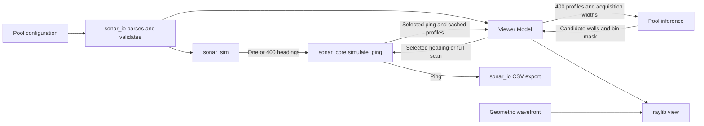

# Simulator architecture and data flow

The simulator is a standalone C++17 application with two entry points. `sonar_sim` exports numerical results to CSV. The optional `sonar_viewer` uses the same simulation core and adds a raylib interface, playback and a pool estimator. See the [README](../README.md#build-and-run) for commands and [sonar theory](sonar-theory.md) for how to interpret the results.



## What one ping computes

1. `simulate_ping(Config, angle_grad)` validates the pool, pose, sonar settings and integer heading (0–399). It creates a grid of range bins that span zero to `max_range_m`. The receiver gate starts at 0.75 m.
2. The core samples the local beam at weighted angular midpoints and rotates each launch direction into pool coordinates. Pool coordinates have Z up and the floor at Z=0. Heading zero points along sonar-local +X and positive angles rotate toward local +Y. Roll, pitch and yaw rotate the sonar frame as a whole.
3. Each ray marches between intersections with the pool's box faces. In `receiver_paths`, the mode used by [pool.cfg](../examples/pool.cfg), a specular return must intersect the effective receiver sphere and satisfy the receive fan. A diffuse return can connect to the receiver centre directly or via one extra reflection when enabled. This mode counts contacts over the whole path. In the API's default `reciprocal` mode, each outward contact can generate an echo by reversing the route. Seeded scatterers optionally contribute straight particle returns.
4. Accepted routes carry vertices, path length, travel time, apparent range and relative energy. The core integrates the in-window arrivals into separate direct, multipath and volume channels. A one-contact surface echo is direct, and a surface echo with more contacts is multipath. The data model keeps particle echoes in their own channel.

The numerical API lives in [simulator.hpp](../include/sonar/simulator.hpp), with the ray, reflection and profile calculations in [simulator.cpp](../src/simulator.cpp). It is deterministic for the same inputs and has no graphics or file dependencies.

## Numerical implementation

The following steps refer to [simulator.cpp](../src/simulator.cpp). Distances are in metres, times are in seconds, and energy values are relative. The model traces straight segments in homogeneous water and integrates the energy of accepted echoes into bins.

### Sample the transmit fan

`fan_offset` places a ray at the midpoint of each cell in a uniform angular grid. For index $i$ in a fan with $N$ cells and width $\Theta$, the offset is

$$
\delta_i = \left(\frac{i+1/2}{N}-\frac12\right)\Theta.
$$

Apply this separately to azimuth and elevation. The azimuth $a$ is the heading plus the horizontal offset. Elevation $e$ is the vertical offset. Convert both to radians for the trigonometry. The local unit direction and normalized weight of a ray are

$$
\mathbf d_{\mathrm{local}} =
\bigl(\cos e\cos a,\ \cos e\sin a,\ \sin e\bigr),
\qquad
w_{ij} =
\frac{\cos e_j}{N_{\mathrm{az}}\sum_k \cos e_k}.
$$

The cosine accounts for the solid angle of an azimuth–elevation cell. All ray weights sum to one. The core transforms directions with the local-to-pool rotation $R_z(\mathrm{yaw})R_y(\mathrm{pitch})R_x(\mathrm{roll})$. With one ray in each axis, both offsets are zero and the ray has unit weight. More rays give denser angular sampling. A finite receiver sphere can still gain or lose discrete ray hits as the grid changes.

### Find the next wall and reflect

For position $\mathbf p$ and unit direction $\mathbf d$, the ray is $\mathbf p+s\mathbf d$. For each axis $i$, `next_hit` chooses the wall coordinate $b_i$ in the direction of travel. It ignores nearly parallel components and takes the smallest candidate distance:

$$
s_i = \frac{b_i-p_i}{d_i},
\qquad
s_{\mathrm{hit}} = \min_i s_i,
\qquad
\mathbf p_{\mathrm{hit}} = \mathbf p+s_{\mathrm{hit}}\mathbf d.
$$

Edge and corner hits can tie numerically. The core marks all faces within the tie tolerance and snaps the relevant coordinates to their planes. Specular continuation reverses every tied normal component. The lowest-numbered tied face supplies the terminal scattering calculation. The contact counter counts the location once.

### Decide whether an echo reaches the receiver

In `receiver_paths`, `trace_receiver_ray` checks capture on each leg *after* at least one contact. Let $\mathbf m=\mathbf p-\mathbf p_{\mathrm{rx}}$ be the ray origin relative to the receiver centre, and $a_{\mathrm{rx}}$ the effective receiver radius. Solving for the first intersection with the sphere gives

$$
b = \mathbf m\cdot\mathbf d,
\qquad
\Delta = b^2-\|\mathbf m\|^2+a_{\mathrm{rx}}^2,
\qquad
s_{\mathrm{entry}} = -b-\sqrt{\Delta}.
$$

The entry must be real, forward and on the available segment before the next wall or the round-trip length limit. The code also checks that the arrival direction, viewed from the receiver in its local frame, lies within ±1° in azimuth of the head and ±12.5° in elevation. The stored route ends at the sphere entry point. The first accepted coherent capture ends that ray's trace.

At each outward wall contact, `diffuse_connections` also tries a direct route to the receiver centre. When enabled, it tries one additional reflection by mirroring the receiver across a candidate wall, intersecting the segment to that image with the wall plane, then using the actual wall point on the return. The extra hit must lie within the face, the diffuse leg must leave into the pool, and the arrival must pass the same angular gate. The limit `max_outward_hits` applies to the **sum of outbound and return contacts** in this mode. In `reciprocal` mode it limits the outward contacts only, and the return route is constructed by copying the outbound vertices in reverse.

### Weight accepted paths

In the roughness model, the coherent energy fraction $S$ uses root mean square roughness $\sigma$, wavelength $\lambda$ and the absolute incidence cosine $\mu$. In `receiver_paths` each coherent reflection multiplies the surviving weight by $R S$, where $R$ is the surface's energy reflection coefficient.

$$
\mu = |\mathbf d\cdot\mathbf n|,
\qquad
S = \exp\!\left[-\left(\frac{4\pi\sigma\mu}{\lambda}\right)^2\right].
$$

For a coherent return of length $L$, `trace_receiver_ray` applies that accumulated survival $P$, a spreading factor with reference distance $r_0=1\,\mathrm m$, and absorption:

$$
I_{\mathrm{spec}}
= w_{ij}\,P
  \left(\frac{r_0}{\max(r_0,L/2)}\right)^4
  \exp(-\alpha L).
$$

A diffuse return uses $R(1-S)B$ in roughness mode, where $B$ is the configured backscatter fraction. It also includes the incoming and outgoing incidence cosines, inverse-square outbound spreading with the same distance clamp, and an aperture factor $a_{\mathrm{rx}}^2/(4L_{\mathrm{ret}}^2)$. For the optional extra return reflection it multiplies by the corresponding $R S$. The legacy receiver-path model instead uses $S=1-B$ for coherent continuation and $RB$ for the diffuse surface term. Particle returns use their own per-particle strength, straight round trips and fan/range checks, independent of the ray count. All these strength terms are modelling choices requiring calibration for quantitative comparisons.

### Integrate arrivals into range bins

`accumulate_profile` places echo energy $I$ from apparent range $r=L/2$ into bins of width $\Delta r$. The arrival must be in the receiver window $[0.75\,\mathrm m,R_{\max})$. For zero-based bin $k$ and rectangular pulse width $w=c\tau/2$, the contribution is

$$
\ell_k = \max\!\left(
    0,\ \min(r+w,(k+1)\Delta r)
      - \max(r,k\Delta r,0.75\,\mathrm m)
    \right),
\qquad
\Delta E_k = I\frac{\ell_k}{w}.
$$

The loop only visits bins inside the grid. For a wholly in-range pulse, summing its bin contributions recovers $I$ apart from rounding. A pulse tail past $R_{\max}$ is lost. A surface arrival below the receive gate can appear in the echo table without contributing any energy, even if its pulse tail would cross the gate.

## A hand-checkable fixture

Save the following as a fresh `wall-check.cfg` and pass `--config wall-check.cfg --angle-grad 0 --output output/wall-check` to `sonar_sim`.

```ini
horizontal_rays=1
vertical_rays=1
return_model=receiver_paths
surface_model=roughness
surface_roughness_m=0
max_outward_hits=1
```

The remaining settings use the API defaults. The sonar is centred at $(5,2.5,1.5)\,\mathrm m$ in the $10\times5\times3\,\mathrm m$ pool, with a 0.05 m aperture and zero particles.

1. The ray goes along +X for 5 m and hits the wall at X=10 m. Normal reflection sends it back along −X.
2. The return enters the sphere at X=5.05 m, after 4.95 m of return travel. It should produce exactly one direct specular echo.
3. The echo should arrive at 6.723 ms and appear at 4.975 m.

$$
L = 5.00\,\mathrm m+4.95\,\mathrm m=9.95\,\mathrm m,
\qquad
t=\frac{9.95\,\mathrm m}{1480\,\mathrm{m/s}},
\qquad
r=\frac{9.95\,\mathrm m}{2}.
$$

With 600 bins over 20 m and a 20 µs pulse, the interval from 4.975 m to 4.9898 m lies within bin 149. That bin should contain all the echo's relative energy in the direct channel. In the compatibility model, the comparable centre-to-centre route is 10 m long and appears at 5 m. The 2.5 cm difference in apparent range comes from where the model terminates the ray.

The [numerical tests](../tests/test_simulator.cpp) include this capture geometry in `receiver_specular_geometry` and check normal-incidence reciprocal lengths and energy in `normal_wall_and_multipath`. For an exported scan, an independent check is to sum the Euclidean distances between consecutive CSV path vertices and compare with `total_path_m`, then compare `travel_time_s` to $L/c$ and `apparent_range_m` to $L/2$. Check that the three channels sum to `total_intensity` per bin. These checks can establish that the geometry, timing and profile calculations agree with the specified model. Assessing how well the model represents the pool requires measured traces.

## CLI and CSV contracts

[src/main.cpp](../src/main.cpp) selects a single heading or a 400-heading scan at a fixed pose. [src/io.cpp](../src/io.cpp) loads the `key=value` configuration and writes three related tables.

| CSV | One row per | Key within one run |
| --- | --- | --- |
| `echoes.csv` | Accepted model return | `(ping_id, echo_id)` |
| `paths.csv` | Vertex on that return, ordered by `vertex_id` | `(ping_id, echo_id, vertex_id)` |
| `profiles.csv` | Range bin with component and combined energy | `(ping_id, bin_index)` |

Join a path to its return using both `ping_id` and `echo_id`. A profile represents the sum of contributions that overlap a bin. To check an echo's range or travel time, use its stored path length and the run's sound speed. Keep the configuration with the exports when comparing runs. The export checks for existing CSV files and rejects reuse of that destination. An interrupted or failed write can leave partial files.

## Viewer state and cache

[Model](../visualization/model.cpp) holds the last valid configuration, the editable draft, the selected `Ping`, the 400 cached profiles and the scan peak. The raylib event loop and resource lifetime are in [visualization/main.cpp](../visualization/main.cpp). The camera, panels, controls and textures are drawn in [view.cpp](../visualization/view.cpp).

| User action | Work performed |
| --- | --- |
| Open, apply a valid draft, reload or confirm a sonar move | Build the selected ping and 400 profiles for the new stationary pose or settings, then refit the pool estimate. An invalid draft leaves the previous valid simulation available. |
| Choose a heading, including while the scan plays | Recompute geometry for the selected ping and heading. Reuse the cached full scan. |
| Change gain, span, camera or channel | Update the view or selection from existing data. The profiles retain their physical values. |
| Change Estimated pool filter strength | Refit the estimate from cached profiles and update the bin mask. |
| Play route | Visit discrete poses and compute a new stationary scan at each. |

[Pool inference](../visualization/inference.cpp) sums the channels and projects candidate range peaks into the sonar-local XY plane. It searches orientations for support across several headings for four orthogonal or opposing wall normals, then refines the most supported orientation and keeps wall sections with enough evidence. The only acquisition inputs are the profiles and their range and pulse parameters.

For a candidate wall with unit normal $\mathbf n$ and offset $h$ from the sonar origin, a heading with unit direction $\mathbf u$ intersects the wall at the predicted range

$$
r_{\mathrm{wall}} = \frac{h}{\mathbf n\cdot\mathbf u}.
$$

The code considers forward intersections on supported sections and retains existing bins near the nearest eligible prediction for each heading. A fit can be partial, and coherent multipath can support a wrong wall. [Pool coordinates](../visualization/pool_coordinates.hpp) uses opposing pairs to estimate displacement from the inferred pool centre. The available axes depend on which wall pairs are supported.

[Wavefront playback](../visualization/wavefront.cpp) samples a separate geometric front by folding propagation into the rectangular box at time $t$. It visualizes one-way propagation and specular direction changes. The return-path view instead follows accepted echo polylines, with each arrival timed by its total path length. Visual playback time and physical travel time have separate scales. The model uses homogeneous water, an ideal box and illustrative reflection and particle coefficients. Calibration, interference and moving-vehicle acquisition are outside its scope.
