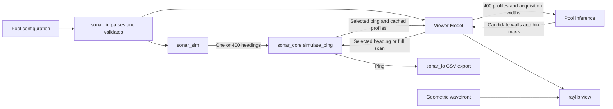

# Simulator architecture and data flow

The simulator is a standalone C++17 application with two entry points. `sonar_sim` exports numerical results to CSV. The optional `sonar_viewer` uses the same simulation core and adds a raylib interface, playback and a pool estimator. See the [README](../README.md#build-and-run) for commands and [sonar theory](sonar-theory.md) for how to interpret the results.

## What one ping computes

1. `simulate_ping(Config, angle_grad)` validates the pool, pose, sonar settings and integer heading (0–399). It creates a grid of range bins that span zero to `max_range_m`. The receiver gate starts at 0.75 m.
2. The core samples the local beam at weighted angular midpoints and rotates each launch direction into pool coordinates. Pool coordinates have Z up and the floor at Z=0. Heading zero points along sonar-local +X and positive angles rotate toward local +Y. Roll, pitch and yaw rotate the sonar frame as a whole.
3. Each ray marches between intersections with the pool's box faces. In `receiver_paths`, the mode used by [pool.cfg](../examples/pool.cfg), a specular return must intersect the effective receiver sphere and satisfy the receive fan. A diffuse return can connect to the receiver centre directly or via one extra reflection when enabled. This mode counts contacts over the whole path. In the API's default `reciprocal` mode, each outward contact can generate an echo by reversing the route. Seeded scatterers optionally contribute straight particle returns.
4. Accepted routes carry vertices, path length, travel time, apparent range and relative energy. The core integrates the in-window arrivals into separate direct, multipath and volume channels. A one-contact surface echo is direct, and a surface echo with more contacts is multipath. The data model keeps particle echoes in their own channel.

The numerical API lives in [simulator.hpp](../include/sonar/simulator.hpp), with the ray, reflection and profile calculations in [simulator.cpp](../src/simulator.cpp). It is deterministic for the same inputs and has no graphics or file dependencies.

## CLI and CSV contracts

[src/main.cpp](../src/main.cpp) selects a single heading or a 400-heading scan at a fixed pose. [src/io.cpp](../src/io.cpp) loads the `key=value` configuration and writes three related tables.

| CSV | One row per | Key within one run |
| --- | --- | --- |
| `echoes.csv` | Accepted model return | `(ping_id, echo_id)` |
| `paths.csv` | Vertex on that return, ordered by `vertex_id` | `(ping_id, echo_id, vertex_id)` |
| `profiles.csv` | Range bin with component and combined energy | `(ping_id, bin_index)` |

Join a path to its return using both `ping_id` and `echo_id`. A profile represents the sum of contributions that overlap a bin. To check an echo's range or travel time, use its stored path length and the run's sound speed. Keep the configuration with the exports when comparing runs. The export checks for existing CSV files and rejects reuse of that destination. An interrupted or failed write can leave partial files.

## Viewer state and cache

[Model](../visualization/model.cpp) holds the last valid configuration, the editable draft, the selected `Ping`, the 400 cached profiles and the scan peak. The raylib event loop and resource lifetime are in [visualization/main.cpp](../visualization/main.cpp). The camera, panels, controls and textures are drawn in [view.cpp](../visualization/view.cpp).

| User action | Work performed |
| --- | --- |
| Open, apply a valid draft, reload or confirm a sonar move | Build the selected ping and 400 profiles for the new stationary pose or settings, then refit the pool estimate. An invalid draft leaves the previous valid simulation available. |
| Choose a heading, including while the scan plays | Recompute geometry for the selected ping and heading. Reuse the cached full scan. |
| Change gain, span, camera or channel | Update the view or selection from existing data. The profiles retain their physical values. |
| Change Estimated pool filter strength | Refit the estimate from cached profiles and update the bin mask. |
| Play route | Visit discrete poses and compute a new stationary scan at each. |

[Pool inference](../visualization/inference.cpp) sums the three channels, finds peaks and looks for cross-angle support for orthogonal wall sections. Its inputs are the profiles and acquisition widths, with no geometry passed in. The estimate can be partial. The retained bins remain original profile values. [Pool coordinates](../visualization/pool_coordinates.hpp) uses opposing wall pairs to estimate displacement from the inferred pool centre. The available axes depend on which wall pairs are supported.

[Wavefront playback](../visualization/wavefront.cpp) samples a separate geometric front by folding propagation into the rectangular box at time $t$. It visualizes one-way propagation and specular direction changes. The return-path view instead follows accepted echo polylines, with each arrival timed by its total path length. Visual playback time and physical travel time have separate scales. The model uses homogeneous water, an ideal box and illustrative reflection and particle coefficients. Calibration, interference and moving-vehicle acquisition are outside its scope.
