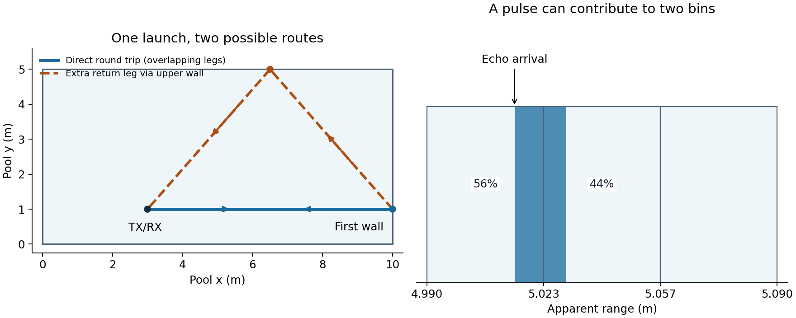
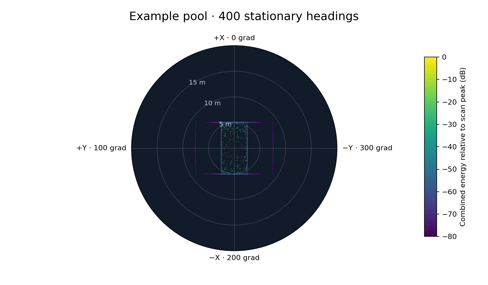

# From a sonar ping to an image

This guide follows one active sonar ping from transmission to the range profile and then to the 360° image. It uses the rectangular pool in the Ping360 simulator as a worked example. See the [system guide](simulator-system.md) for the code and the [README](../README.md#calculation) for the implemented model equations.

## Time of flight and apparent range

An active sonar emits a short acoustic pulse and listens for returning energy. The Ping360 rotates a single transducer mechanically. Each ping produces a series of return-strength samples at one head angle. The nominal beam spans 2° horizontally and 25° vertically, so a heading is a narrow horizontal sector with much less information about elevation. In the simulator the fan is sampled with weighted rays. The example uses 3 horizontal × 11 vertical rays per heading. [Ping360 specifications](https://bluerobotics.com/store/sonars/imaging-sonars/ping360-sonar-r1-rp/) · [Ping360 protocol](https://docs.bluerobotics.com/ping-protocol/pingmessage-ping360/)

In monostatic sonar, the transmitter and receiver share essentially the same location. With constant sound speed $c$, the arrival time $t$ is set by the sum of the outward and return path lengths, $L_{\mathrm{out}}$ and $L_{\mathrm{ret}}$. The display converts that time to **apparent range** $r_{\mathrm{app}}$ by assuming a straight round trip.

$$
L = L_{\mathrm{out}} + L_{\mathrm{ret}},
\qquad
t = \frac{L}{c},
\qquad
r_{\mathrm{app}} = \frac{ct}{2} = \frac{L}{2}.
$$

For a wall 5 m away at normal incidence, both legs are 5 m. At the example sound speed, the expected delay is

$$
t = \frac{5\,\mathrm{m} + 5\,\mathrm{m}}{1480\,\mathrm{m/s}}
  \approx 6.76\,\mathrm{ms}.
$$

For a fixed measured delay, a 1% error in the assumed sound speed produces a 1% error in estimated range. For a path with several reflections, the same conversion still gives half the travelled distance. Its displayed location can therefore lie beyond the wall that first reflected the sound.

## Beamwidth and angle sampling

The mechanical heading changes in increments of 0.9°. That increment determines where adjacent profiles are centred. Beamwidth determines the angular region that can contribute to a single profile. A reflector can appear in neighbouring headings because the horizontal beam is about 2° wide.

For a flat cross-section perpendicular to the beam axis at distance $r$, an angular width $\theta$ gives an approximate footprint width $W$:

$$
W(r,\theta) = 2r\tan\!\left(\frac{\theta}{2}\right).
$$

At 5 m, that gives about **0.17 m horizontally** and **2.22 m vertically** for the nominal fan. This calculation treats the beam edges as geometric limits. The actual response varies smoothly across direction, while the simulator uses a uniform fan with finite angular support. A polar image collapses the elevation dimension, so returns from different heights can land at the same displayed heading and range. [Ping360 specifications](https://bluerobotics.com/store/sonars/imaging-sonars/ping360-sonar-r1-rp/)

## Reflections and multipath

A smooth surface produces specular reflection. For an incoming unit direction $\mathbf d$ and a unit surface normal $\mathbf n$, the dot product gives the signed normal component. Subtracting that component twice reverses it and preserves the tangential component.

$$
\mathbf d_{\mathrm{ref}}
= \mathbf d - 2(\mathbf d\cdot\mathbf n)\,\mathbf n.
$$

A specular echo reaches a monostatic receiver from a single flat wall most readily near normal incidence. At an oblique angle the reflected ray can miss the receiver. Surface roughness spreads some energy away from the specular direction, which can produce a return even when the specular ray misses. Particles or bubbles give rise to volume scattering inside the water. Rays describe propagation geometry, while diffraction, interference and acoustic pressure require a wave description. [Aalto University, geometrical acoustics](https://research.cs.aalto.fi/acoustics/virtual-acoustics/research/room-acoustics-modeling/69-geometrical-acoustics.html)

The wavelength $\lambda$ is set by sound speed and acoustic frequency $f$.

$$
\lambda = \frac{c}{f}
= \frac{1480\,\mathrm{m/s}}{750\,000\,\mathrm{Hz}}
\approx 1.97\,\mathrm{mm}.
$$

Roughness matters relative to this wavelength and to the direction of incidence. For example, the same height variations introduce smaller reflected path differences at grazing incidence than at normal incidence. The simulator uses an exponential coherent-energy factor based on this relationship. Its fitted inputs would need measured pool data to support quantitative echo-strength predictions. [TU Delft, interaction of sound with the seafloor, §4.2.3](https://ocw.tudelft.nl/wp-content/uploads/Reader_chapter_4_01.pdf)

**Left.** The straight path is 14 m in total and appears at 7 m. The dashed return via the upper wall gives a total path of about 17.63 m and appears at 8.82 m. This sketch isolates geometry. The dashed path arrives about 49° off the outgoing axis, which puts it outside the example receiver beam for that heading. Real echoes that do pass the receive gate can overlap at the same apparent range. Bright points and extended wall-like patterns can therefore arise from more than one reflection.

## Echo strength and two-way loss

An ideal point scatterer in freely spreading sound receives intensity proportional to the inverse square of its distance from the transmitter. The scattered sound spreads again on its way to the receiver. For equal leg lengths $r$, the resulting scaling is

$$
\frac{1}{L_{\mathrm{out}}^2}\frac{1}{L_{\mathrm{ret}}^2}
=\frac{1}{r^4},
\qquad L_{\mathrm{out}}=L_{\mathrm{ret}}=r.
$$

Under those assumptions, doubling range reduces intensity to one sixteenth, about 12 dB down before absorption. Absorption adds loss along both legs. The simulator represents that factor as $\exp(-\alpha L)$, with an energy attenuation coefficient $\alpha$ in inverse metres. Extended walls and pool reverberation can depart from simple point-scatterer scaling. The model combines spreading with route-specific reflection, scattering and capture terms. The real hardware supplies sampled return-strength bytes shaped by receiver response and gain. [Ainslie and Leighton, active sonar equation and two-way propagation loss, pp. 27–28](https://eprints.soton.ac.uk/398067/) · [Ping360 protocol](https://docs.bluerobotics.com/ping-protocol/pingmessage-ping360/)

## Pulse duration, range bins and the image

The simulator spreads each in-window arrival over a causal rectangular pulse. The pulse width on the range axis, $w$, comes from the transmit duration $\tau$. The bin spacing $\Delta r$ comes from the maximum range $R_{\max}$ and the number of bins $N$.

$$
w = \frac{c\tau}{2}
= \frac{1480\,\mathrm{m/s}\ \cdot\ 20\,\mu\mathrm{s}}{2}
= 14.8\,\mathrm{mm},
\qquad
\Delta r = \frac{R_{\max}}{N}
= \frac{20\,\mathrm{m}}{600}
\approx 33.3\,\mathrm{mm}.
$$

Pulse width sets how far one arrival spreads in this model, and bin width sets how finely that spread is sampled. A short pulse can still cross a bin boundary. Two arrivals can also add energy to the same bin. Actual range resolution depends on the waveform, bandwidth and receiver processing as well as the sample interval.

**Right panel above.** In a schematic grid with 33.3 mm bins, the 14.8 mm pulse starts just before a bin boundary. About 56% of its energy falls in the first bin and 44% in the next. The simulator assigns energy by this overlap and clips pulse tails at the maximum range. An arrival outside the receive window contributes zero to the profile.

Each radial slice is a profile from one stationary heading. The plot uses `total_intensity` from a scan of [the example pool](../examples/pool.cfg). For a bin with combined energy $E>0$, the plotted level uses the maximum combined energy $E_{\mathrm{peak}}$ across the entire scan.

$$
D = 10\log_{10}\!\left(\frac{E}{E_{\mathrm{peak}}}\right)\,\mathrm{dB}.
$$

The strongest bin is therefore 0 dB. At −20 dB a bin has 1% of the peak energy. The plot shows an 80 dB span, and rings mark 5 m increments of apparent range up to 20 m. The inner rectangle follows the main wall returns, while extra traces and dots illustrate multipath and particle returns. A new scan can have a different peak, so equal colours across scans can represent different energies.
