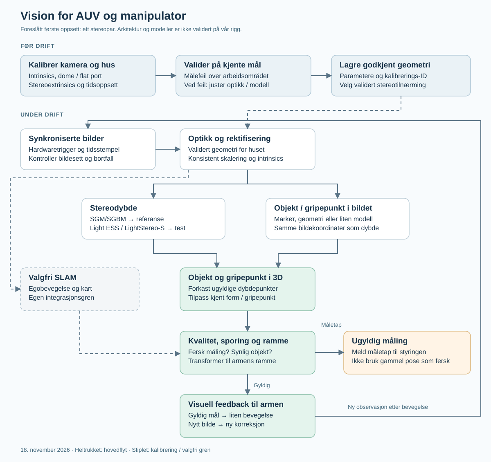
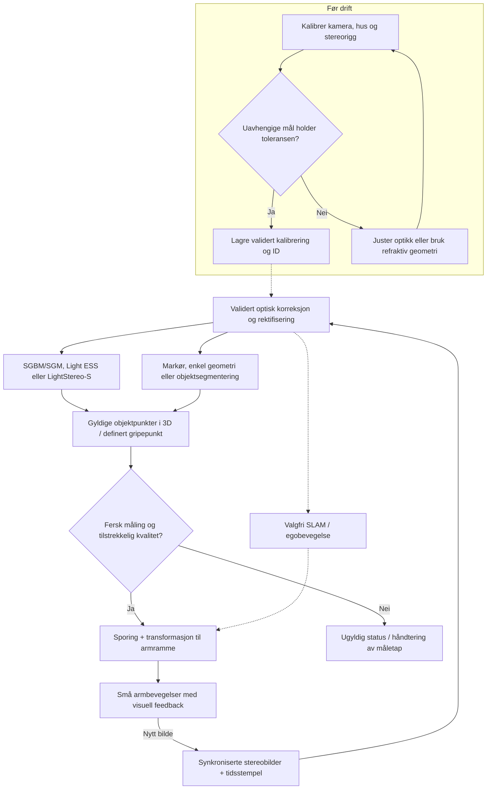

# Visuell vision-pipeline

**Forslag, ikke implementert.** Diagrammet viser første oppsett med ett stereopar. Optisk validering må være godkjent før den vanlige rektifiserte stereogrenen brukes.

## Redigerbart diagram

## Foreslått grensesnitt

Dette er en konseptuell datakontrakt, ikke et eksisterende ROS-meldingsformat.

| Felt | Betydning |
| --- | --- |
| `stamp`, `frame_id` | Eksponeringstid og koordinatsystem for målingen |
| `calibration_id`, `model_id` | Geometri og modellversjon som faktisk ble brukt |
| `object_id`, `class_id` | Sporet objekt og eventuell klasse |
| `position_m` | Definert referansepunkt, oppgitt i meter |
| `orientation` | Bare når orientering er estimert og nødvendig |
| `grasp_point_m` | Gripepunkt som er definert for oppgaven |
| `measurement_status`, `age_ms` | Observert, predikert eller ugyldig; alder på siste observasjon |
| `valid_fraction`, `quality` | Gyldig punktandel og dokumentert kvalitetsmål |
| `covariance` | Empirisk validert usikkerhet hvis tilgjengelig; skal ikke diktes fra nettverksscore |

Kameraenes transformasjoner og armkinematikk må koble kamerarammen til armrammen. Global AUV-pose er valgfri for lokal griping. Ved sporing over tid må bevegelse mellom måletidspunktene håndteres eksplisitt.

Heltrukne piler i SVG viser hovedflyt; stiplede viser kalibrering og valgfri egobevegelse. Kontrollsløyfen bruker en ny observasjon etter bevegelse. Tap av gyldig måling skal ha egen status.
