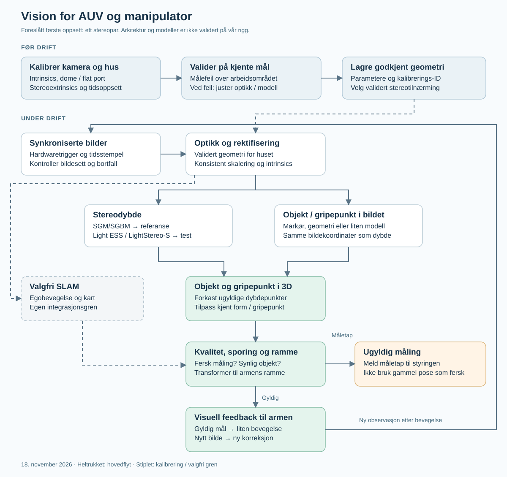

# Vision for Sub Horizon AUV

Kort rapport og arbeidsgrunnlag for stereovisjon, objektlokalisering og manipulasjon under vann.

**Status 18. november 2026:** Arkitekturforslag og research. Ingen modeller, kalibreringer eller ROS-noder er implementert eller ytelsesvalidert i denne mappen.

## Start her

- [Kort rapport: anbefalt vision-pipeline](RAPPORT.md)
- [Visuell pipeline og redigerbart diagram](PIPELINE.md)
- [Modeller og valgkriterier](MODELLER.md)
- [Testplan og beslutningsporter](TESTPLAN.md)
- [Forskningsartikler, verktøy og kildeoversikt](references/README.md)
- [Opprinnelig kalibreringsnotat](bakgrunn/KALIBRERING_START_HER.md)

## Foreløpig anbefaling

Start med ett synkronisert stereopar, domehus som foreløpig hovedspor, Calibmar-kalibrering og en klassisk stereoreferanse. Evaluer Light ESS og LightStereo-S på Jetson Orin Nano. Finn et definert gripepunkt med markør, enkel geometri eller liten segmenteringsmodell, og korriger tilnærmingen løpende med visuell feedback.

Geometrien gjennom huset må være validert før disparitet tolkes som metrisk dybde. Flere stereopar, SLAM og tyngre posemodeller legges til etter behov og målinger.

Tredjepartskode, modellvekter og store datasett hentes fra originalkildene i [kildeoversikten](references/README.md). Implementasjonskode kan senere plasseres i repoets `software/`.
