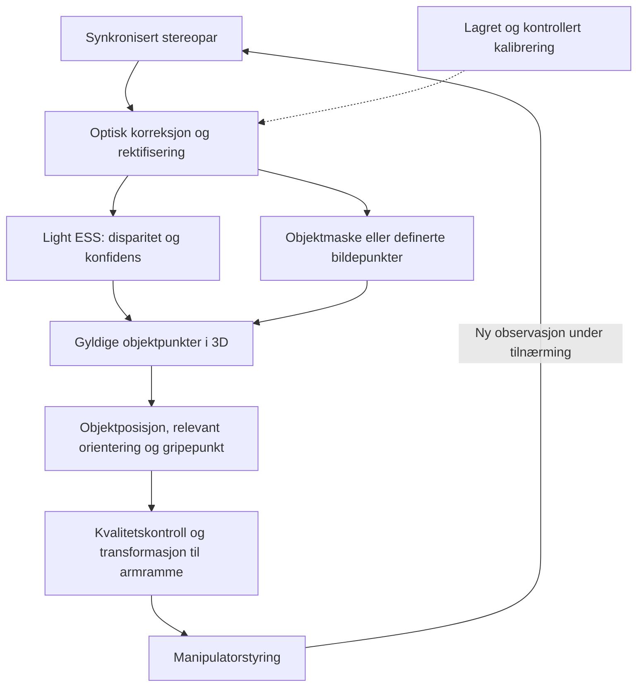

# Kort rapport: planlagt vision-pipeline

**Dato:** 24. november 2026.

**Status:** Beskrivelse av kandidatarkitekturen. Ingen implementasjon eller måleresultater følger av denne rapporten.

## Formål

Pipelinen skal omforme synkroniserte stereobilder til en kvalitetskontrollert objektmåling og et definert gripepunkt. Beregningen planlegges kjørt om bord på Jetson Orin Nano Super 8 GB.

## 1. Opptak og geometrisk behandling

Kameraene tar et bildepar med felles eksponeringstid eller tilstrekkelig presis synkronisering. Bildene får tidsstempler, og feilparede eller manglende bilder forkastes.

Den lagrede kalibreringen brukes til optisk korreksjon og rektifisering, slik at samsvarende punkter ligger langs samme bilderad. Husets lysbrytning må håndteres med en validert modell eller tilnærming. Ved beskjæring eller reskalering oppdateres kameraparametrene tilsvarende. Calibmar leverer kalibreringsparametere; korreksjonen som bruker dem under drift må implementeres og kontrolleres separat. [Calibmars geometribeskrivelse](https://mdskiel.github.io/calibmar_documentation/should_i_calibrate_my_housing.html).

## 2. Dybde og objektlokalisering

Light ESS beregner disparitet og konfidens fra det rektifiserte stereoparet. Modellinput er 480 × 288 piksler. Disparitet omregnes til metrisk dybde med den validerte stereogeometrien. Lavkonfidenspunkter og ugyldige målinger forkastes. Nettverkets konfidens er ikke i seg selv en målt avstandsfeil. [NVIDIAs modellkort](https://catalog.ngc.nvidia.com/orgs/nvidia/teams/isaac/models/dnn_stereo_disparity).

En parallell gren finner objektet gjennom enkel geometri eller segmentering. Masken eller bildepunktene må være registrert mot samme bildegeometri og oppløsning som dybden. Dette er særlig viktig dersom objektmodellen bruker høyere oppløsning enn Light ESS.

## 3. Objektmåling og gripepunkt

Gyldige dybdepunkter innenfor objektet brukes til å estimere et definert referansepunkt og, når oppgaven krever det, orientering. Kjent form kan brukes til geometrisk tilpasning. Et gjennomsnitt av synlige overflatepunkter er ikke automatisk objektets sentrum eller et egnet gripepunkt.

Målingen transformeres fra kamerarammen til armrammen med kjent montering og armkinematikk. Resultatet omfatter posisjon, eventuelt orientering, gripepunkt, tidsstempel, referanseramme og gyldig status.

## 4. Visuell tilbakemelding og kontroll

Manipulatorstyringen mottar nye målinger under tilnærmingen og korrigerer bevegelsen. Gamle, predikerte og ugyldige målinger skilles fra ferske observasjoner. Ved måletap må styringen bruke en avklart respons, for eksempel holde posisjon eller avbryte tilnærmingen.

Før integrasjon må hele kjeden testes for 3D-feil, orienteringsfeil, gyldig dekning, målingsalder, latenstid, minnebruk og temperatur. Referansemål i vann skal dekke både arbeidsavstandene og relevante deler av bildeflaten. SLAM er en mulig separat utvidelse og er ikke en forutsetning for første lokale gripetest.

[Arkitektur og plan](ARKITEKTUR.md) · [Testgrunnlag](../research/TESTPLAN.md) · [Research](../research/README.md)
