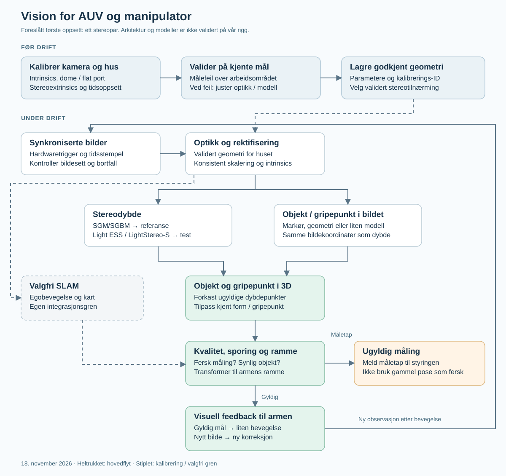

# Research for vision

Undersøkelser, faglige vurderinger og alternativer for stereovisjon, objektlokalisering og manipulasjon under vann.

Materialet fra 18. november 2026 er bevart som researchgrunnlag. Anbefalinger i disse dokumentene er forslag, ikke endelige designvalg eller målte resultater. Den oppdaterte arbeidsplanen ligger i [kandidatarkitektur](../kandidatarkitektur/ARKITEKTUR.md).

## Start her

- [Kort rapport: anbefalt vision-pipeline](RAPPORT.md)
- [Visuell pipeline og redigerbart diagram](PIPELINE.md)
- [Modeller og valgkriterier](MODELLER.md)
- [Testplan og beslutningsporter](TESTPLAN.md)
- [Forskningsartikler, verktøy og kildeoversikt](references/README.md)
- [Opprinnelig kalibreringsnotat](bakgrunn/KALIBRERING_START_HER.md)

## Funn og avklaringer 24. november 2026

- **Light ESS:** Kandidat for første integrasjon. Modellen gir disparitet og konfidens med input på 480 × 288 piksler. Dette er ikke dokumentasjon på nødvendig gripepresisjon under vann. [Modellkort](https://catalog.ngc.nvidia.com/orgs/nvidia/teams/isaac/models/dnn_stereo_disparity).
- **Egen trening:** De gjennomgåtte ESS-kildene beskriver inferens, men dokumenterer ikke en offentlig støttet treningsløype for prosjektets egen finjustering. Muligheten er uavklart. [Isaac ROS](https://github.com/NVIDIA-ISAAC-ROS/isaac_ros_dnn_stereo_depth). LightStereo/OpenStereo er et alternativ med treningskode dersom egen tilpasning blir nødvendig. [OpenStereo](https://github.com/XiandaGuo/OpenStereo).
- **Kalibrering:** Calibmar estimerer kamera-, hus- og stereoparametere. Bruk av husparametrene i den kjørende rektifiseringen er en egen integrasjonsoppgave. En vanlig pinhole-tilnærming må kontrolleres mot faktiske avstander og synsfelt. [Calibmar](https://mdskiel.github.io/calibmar_documentation/should_i_calibrate_my_housing.html).
- **Målplattform:** Arbeidsplanen bruker Jetson Orin Nano Super 8 GB. Publiserte NVIDIA-målinger erstatter ikke måling av komplett pipeline på prosjektets rigg. [NVIDIA](https://github.com/NVIDIA-ISAAC-ROS/isaac_ros_dnn_stereo_depth#performance).

Tredjepartskode, modellvekter og store datasett hentes fra originalkildene i [kildeoversikten](references/README.md). Det er ikke registrert målte resultater i [resultatmalen](benchmarks/resultater.csv).
